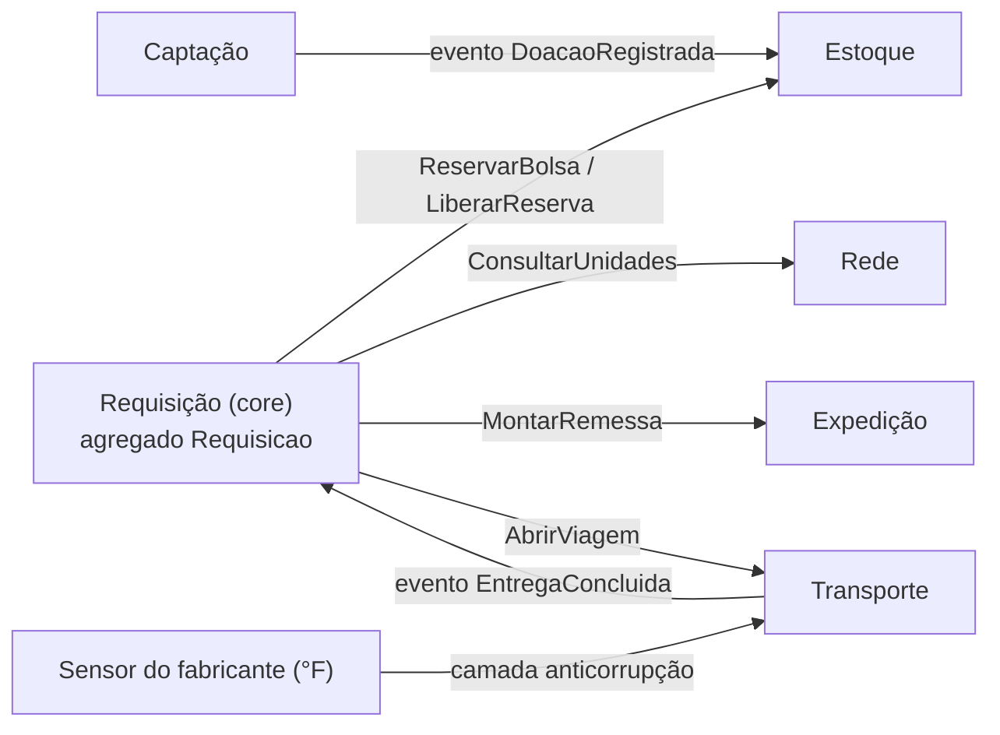

# Rota Vital · Parte 3: DDD em código

> **Trabalho U2 · Parte 3 (entrega final)** · Infraestrutura de Software · ADS · CESAR School · 2026.2 · Squad **Hemotrack**

O Rota Vital da Parte 1 refatorado com o planejamento da Parte 2: **seis bounded contexts como pacotes, três camadas em cada um, o agregado Requisição protegendo as invariantes, o cenário Gherkin da Parte 2 rodando com Cucumber, testes de domínio em TDD na esteira e a versão nova publicada pelo mesmo deploy da Parte 1.**

| | |
|---|---|
| 🌐 **Site no ar** | https://hemocentro-api.onrender.com (mesmo serviço da Parte 1, agora com a versão refatorada; ver [Deploy](#6-esteira-deploy-e-teste-de-fumaça)) |
| 🔖 **Versão publicada** | https://hemocentro-api.onrender.com/api/info (campo `versao` = SHA do commit) |
| 📦 **Repositório** | https://github.com/egs3-coder/Parte-3-SO |
| ⚙️ **Esteira** | https://github.com/egs3-coder/Parte-3-SO/actions |
| 🔴🟢 **Ciclo TDD** | [PR #1 · Agregado Requisição em TDD](https://github.com/egs3-coder/Parte-3-SO/pull/1) (vermelho → verde → refatoração) |
| 🧭 **Planejamento (Parte 2)** | [`docs/arquitetura/`](docs/arquitetura/) · repositório [Trabalho-U2-Parte-2](https://github.com/egs3-coder/Trabalho-U2-Parte-2-Planejamento-da-remodelagem) |
| 🐳 **Base (Parte 1)** | repositório [SO](https://github.com/egs3-coder/SO) |

Java 21 · Spring Boot 3.5 · PostgreSQL 17 · Flyway · JUnit 5 · ArchUnit · Cucumber 7 · Testcontainers · Docker · GitHub Actions · GHCR · Render

---

## Sumário

1. [Equipe](#1-equipe)
2. [Arquitetura](#2-arquitetura) (contextos, camadas, agregados, regra de dependência, comunicação, diferenças em relação à Parte 2)
3. [Modelo de domínio](#3-modelo-de-domínio)
4. [Como rodar](#4-como-rodar)
5. [Testes: TDD, BDD e ArchUnit](#5-testes-tdd-bdd-e-archunit)
6. [Esteira, deploy e teste de fumaça](#6-esteira-deploy-e-teste-de-fumaça)
7. [SDD: especificações antes do código](#7-sdd-especificações-antes-do-código)
8. [Uso de IA](#8-uso-de-ia)
9. [Roteiro da apresentação (01/12)](#9-roteiro-da-apresentação-0112)
10. [Checklist do enunciado](#10-checklist-do-enunciado)

---

## 1. Equipe

| Integrante | Papel | Na Parte 3 explica |
| --- | --- | --- |
| Ewerton Guilherme da Silva | Product Owner | Abertura, esteira/deploy e Uso de IA |
| Pablo Arthur Eustáquio de Lima | Backend | Contextos e camadas (seção A) |
| João Ricardo Alves de Brito | Backend | Agregado Requisição e compatibilidade (seção B) |
| Lucas Aprigio dos Santos | Backend | Testes: TDD, Cucumber, ArchUnit (seção C) |
| Saulo Eduardo Almeida dos Santos | Backend | Eventos e saga entre contextos (opcional) |
| Thiago Cardozo da Conceição | Frontend / UI | Fluxo de ponta a ponta na página |
| Eloi de Lima Sousa | Frontend / UI | Transporte, telemetria e camada anticorrupção |

A divisão de fala é uma sugestão a partir da Parte 2; o professor pode chamar qualquer pessoa para qualquer parte.

---

## 2. Arquitetura

Monolito modular (decisão do [ADR 0001](docs/arquitetura/adr/0001-decomposicao.md)): **um pacote por bounded context**, cada um com **as mesmas três camadas**, e todas as dependências apontando para o domínio. Documentação completa da Parte 2 em [`docs/arquitetura/`](docs/arquitetura/) ([documento](docs/arquitetura/documento.md), [mapa de contextos](docs/arquitetura/img/mapa-de-contextos.png), [regra de dependência](docs/arquitetura/img/regra-de-dependencia.png), [ADRs](docs/arquitetura/adr/)).

### 2.1 Contextos e onde está cada agregado

| Contexto | Pacote | Agregado (raiz) | Responsabilidade |
| --- | --- | --- | --- |
| **Requisição** (core) | [`requisicao`](src/main/java/br/cesar/rotavital/requisicao) | [`Requisicao`](src/main/java/br/cesar/rotavital/requisicao/negocio/dominio/Requisicao.java) → `ItemRequisicao` → `AlocacaoBolsa` | Recebe o pedido, aplica prioridade e compatibilidade, orquestra a saga até a entrega |
| **Estoque** | [`estoque`](src/main/java/br/cesar/rotavital/estoque) | [`Bolsa`](src/main/java/br/cesar/rotavital/estoque/negocio/dominio/Bolsa.java) | Dono da verdade das bolsas: validade, reserva, liberação, descarte, estoque crítico |
| **Expedição** | [`expedicao`](src/main/java/br/cesar/rotavital/expedicao) | [`Remessa`](src/main/java/br/cesar/rotavital/expedicao/negocio/dominio/Remessa.java) | Monta a remessa e emite a guia |
| **Transporte** (core) | [`transporte`](src/main/java/br/cesar/rotavital/transporte) | [`Viagem`](src/main/java/br/cesar/rotavital/transporte/negocio/dominio/Viagem.java) | Viagem, telemetria da caixa, excursões de temperatura, chegada |
| **Rede** | [`rede`](src/main/java/br/cesar/rotavital/rede) | [`UnidadeSolicitante`](src/main/java/br/cesar/rotavital/rede/negocio/dominio/UnidadeSolicitante.java) | Hospitais e unidades (serviço aberto consultado pela Requisição) |
| **Captação** (novo) | [`captacao`](src/main/java/br/cesar/rotavital/captacao) | [`Doador`](src/main/java/br/cesar/rotavital/captacao/negocio/dominio/Doador.java), [`Doacao`](src/main/java/br/cesar/rotavital/captacao/negocio/dominio/Doacao.java) | Triagem e doação da Parte 1 (H1, H2 e as regras da Release 2) |

Além dos contextos: [`compartilhado`](src/main/java/br/cesar/rotavital/compartilhado) é o **núcleo compartilhado** (shared kernel: `TipoSanguineo`, `Hemocomponente`, `Validade`, `CodigoBolsa`) e [`portal`](src/main/java/br/cesar/rotavital/portal) é só apresentação transversal (página, `/api/info`, `/api/resumo`, tradução de erros), sem regra nem tabela.

### 2.2 As três camadas dentro de cada contexto

```
br.cesar.rotavital
├── requisicao                       (o mesmo formato vale para os outros cinco contextos)
│   ├── apresentacao                 RequisicaoController (HTTP, DTOs, validação de formato)
│   ├── negocio
│   │   ├── aplicacao                casos de uso: RegistrarRequisicao, AlocarBolsa, AtenderRequisicao,
│   │   │                            DespacharRequisicao, CancelarRequisicao, ConsultarRequisicoes,
│   │   │                            ConfirmarEntregaAoConcluirViagem (consome evento)
│   │   └── dominio                  Requisicao, ItemRequisicao, AlocacaoBolsa, objetos de valor e PORTAS:
│   │                                RequisicaoRepository, EstoqueGateway, RedeGateway, ExpedicaoGateway, TransporteGateway
│   └── dados                        RequisicaoRepositoryJdbc, EstoqueClient, RedeClient, ExpedicaoClient, TransporteClient
├── estoque      apresentacao · negocio/aplicacao · negocio/dominio · dados (BolsaRepositoryJpa)
├── expedicao    apresentacao · negocio/aplicacao · negocio/dominio · dados (RemessaRepositoryJpa)
├── transporte   apresentacao (TradutorSensorFabricante) · negocio/aplicacao · negocio/dominio · dados
├── rede         apresentacao · negocio/aplicacao · negocio/dominio · dados
├── captacao     apresentacao · negocio/aplicacao · negocio/dominio · dados
├── compartilhado   dominio (shared kernel) · aplicacao (exceções NaoEncontrado, Conflito)
└── portal          página, /api/info, /api/resumo, TratamentoDeErros (Problem Details, RFC 9457)
```

### 2.3 Regra de dependência (verificada a cada push)

Apresentação → aplicação → domínio; dados → domínio (implementa as portas). O domínio é Java puro: **não importa Spring, JPA, controller nem repositório concreto**. A regra não fica só no papel: [`RegraDeDependenciaTest`](src/test/java/br/cesar/rotavital/arquitetura/RegraDeDependenciaTest.java) (ArchUnit) roda no `mvn test` da esteira e falha se:

| Regra | Teste |
| --- | --- |
| `..negocio.dominio..` só depende de `java..` e de domínio | `dominioSemFramework` |
| `..negocio.aplicacao..` não importa `..dados..`, `..apresentacao..`, JPA nem Spring Web | `aplicacaoNaoConheceDados` |
| apresentação e portal não importam `..dados..` | `apresentacaoNaoConheceDados` |
| `jakarta.persistence` só aparece em `..dados..` | `jpaSoEmDados` |
| um contexto não importa domínio, dados nem apresentação de outro (para cada um dos 6) | `contextoNaoAcessaInternosDeOutro` |
| o núcleo compartilhado não conhece nenhum contexto; não há ciclo entre contextos | `nucleoCompartilhadoIndependente`, `semCiclos` |

### 2.4 Comunicação entre contextos: interface pública ou evento

**Nenhum contexto acessa as tabelas de outro.** Cada contexto tem o seu schema no PostgreSQL ([`V2__um_schema_por_contexto.sql`](src/main/resources/db/migration/V2__um_schema_por_contexto.sql), [`V3__requisicao.sql`](src/main/resources/db/migration/V3__requisicao.sql)) e não há chave estrangeira entre schemas.

| De → para | Como | Onde no código |
| --- | --- | --- |
| Requisição → Estoque | Comando pela interface pública: `ReservarBolsa.reservar/liberar` | porta [`EstoqueGateway`](src/main/java/br/cesar/rotavital/requisicao/negocio/dominio/EstoqueGateway.java) → adaptador [`EstoqueClient`](src/main/java/br/cesar/rotavital/requisicao/dados/EstoqueClient.java) |
| Requisição → Rede | Consulta (serviço aberto): `ConsultarUnidades.buscar` | `RedeGateway` → `RedeClient` |
| Requisição → Expedição | Comando `MontarRemessa` (idempotente) | `ExpedicaoGateway` → `ExpedicaoClient` |
| Requisição → Transporte | Comando `AbrirViagem` (ponto sem volta da saga) | `TransporteGateway` → `TransporteClient` |
| **Captação → Estoque** | **Evento** `DoacaoRegistrada` (`ApplicationEventPublisher` + `@EventListener`, em memória, mesma transação) | [`RegistrarDoacao`](src/main/java/br/cesar/rotavital/captacao/negocio/aplicacao/RegistrarDoacao.java) publica · [`EntradaDeBolsaPorDoacao`](src/main/java/br/cesar/rotavital/estoque/negocio/aplicacao/EntradaDeBolsaPorDoacao.java) consome |
| **Transporte → Requisição** | **Evento** `EntregaConcluida` | [`ConcluirEntrega`](src/main/java/br/cesar/rotavital/transporte/negocio/aplicacao/ConcluirEntrega.java) publica · [`ConfirmarEntregaAoConcluirViagem`](src/main/java/br/cesar/rotavital/requisicao/negocio/aplicacao/ConfirmarEntregaAoConcluirViagem.java) consome |
| Sensor do fabricante → Transporte | Camada anticorrupção (°F → °C) | [`TradutorSensorFabricante`](src/main/java/br/cesar/rotavital/transporte/apresentacao/TradutorSensorFabricante.java) |



O opcional do enunciado (evento entre contextos) está feito duas vezes: `DoacaoRegistrada` e `EntregaConcluida`.

### 2.5 Diferenças em relação ao plano da Parte 2 (e por quê)

| Plano da Parte 2 | No código | Por quê |
| --- | --- | --- |
| Cinco contextos | **Seis**: entrou `captacao` | A Parte 1 tinha triagem e doação (H1, H2 e a Release 2). Em vez de jogar fora, viraram um contexto; a doação alimenta o Estoque por evento. |
| `alocar(itemId, BolsaReservada)` | Igual | O caso de uso pede a reserva ao Estoque primeiro e entrega a `BolsaReservada` ao agregado; se o agregado recusar, a reserva é liberada (compensação). A spec foi revisada antes do código ([commit](https://github.com/egs3-coder/Parte-3-SO/commit/9c42e13)). |
| `TipoSanguineo`, `Hemocomponente`, `Validade` no contexto Requisição | No **núcleo compartilhado** (`compartilhado.dominio`) | Estoque, Captação e Requisição usam o mesmo conceito (glossário A.3). Shared kernel: mudar exige acordo dos contextos, e o ArchUnit garante que ele não depende de ninguém. |
| `RequisicaoRepositoryJpa` | `RequisicaoRepositoryJdbc` (SQL explícito) | O agregado tem duas coleções aninhadas (itens → alocações). Com SQL fica claro o que é gravado e o domínio continua sem anotação. Os demais contextos usam JPA. |
| `SensorTelemetriaAdapter` na camada de dados | `TradutorSensorFabricante` na **apresentação** do Transporte | A leitura chega por HTTP; a tradução fica na borda de entrada, antes do caso de uso. Continua sendo camada anticorrupção. |
| Saga com broker e outbox (ADR 0002) | Comandos por interface pública + eventos em memória, numa transação | No monolito a consistência é ACID (ADR 0001); o outbox fica para quando houver broker. As portas são as mesmas que virariam mensagens. |
| Reserva com expiração de 30 min | Sem expiração | Fora do escopo desta entrega (registrado na [spec](specs/estoque/reservar-bolsa.md)). |

---

## 3. Modelo de domínio

### 3.1 Agregado Requisição: a raiz protege as invariantes

[`Requisicao`](src/main/java/br/cesar/rotavital/requisicao/negocio/dominio/Requisicao.java) é a única porta de entrada: `ItemRequisicao` e `AlocacaoBolsa` não têm método público que mude estado, as listas devolvidas são somente leitura e toda recusa acontece **antes** de qualquer alteração.

| Invariante (Parte 2) | Mensagem de recusa (linguagem ubíqua) | Teste |
| --- | --- | --- |
| **I1** mesmo hemocomponente do item | "Hemocomponente diferente do pedido" | `RequisicaoTest.Alocar.hemocomponenteDiferente` |
| **I1** compatível pela regra do hemocomponente (plasma inverte, Rh não conta) | "Tipo sanguíneo incompatível" | `RequisicaoTest.Alocar.hemaciasIncompativel`, `.plasma`, `HemocomponenteCompatibilidadeTest` |
| **I2** válida na entrega prevista (agora + prazo da prioridade) | "Bolsa vence antes da entrega prevista" | `RequisicaoTest.Alocar.venceAntesDaEntrega`, `.venceNaEntrega` |
| **I3** item não passa da quantidade; bolsa não se repete; ao menos um item | "Item já está completo", "Bolsa já alocada nesta requisição", "A requisição precisa de ao menos um item" | `RequisicaoTest.Alocar.itemCompleto`, `.bolsaRepetida`, `Registro.semItens` |
| **I4** emergência exige justificativa clínica | "Requisição de emergência exige justificativa clínica" | `RequisicaoTest.Registro.emergencia` |
| **I5** REGISTRADA → EM_ATENDIMENTO → ATENDIDA → EM_TRANSPORTE → ENTREGUE (ou CANCELADA) | "Requisição só fica atendida com todos os itens completos" etc. | `RequisicaoTest.CicloDeVida.*` |

### 3.2 Objetos de valor (imutáveis, validados no construtor)

`TipoSanguineo`, `Hemocomponente` (com `compativel(bolsa, receptor)` e validade por hemocomponente), `Validade`, `CodigoBolsa` (núcleo compartilhado); `Prioridade` (prazo de entrega), `Quantidade` (1 a 20), `JustificativaClinica` (até 500 caracteres), `RequisicaoId`, `ItemId`, `UnidadeSolicitanteId`, `BolsaReservada` (Requisição); `Cpf` com dígitos verificadores (Captação); `FaixaTemperatura`, `LeituraTelemetria` (Transporte); `GuiaRemessa` (Expedição); `CodigoUnidade`, `Endereco` (Rede).

Os nomes do glossário da Parte 2 aparecem nas classes, métodos, mensagens e testes (`alocar`, `marcarAtendida`, `confirmarEntrega`, `reservar`, `liberar`, `excursoes`, `entregaPrevista`…).

---

## 4. Como rodar

Pré-requisito: Docker.

```bash
git clone https://github.com/egs3-coder/Parte-3-SO.git && cd Parte-3-SO
cp .env.example .env            # ajuste a senha
docker compose up -d --build
docker compose ps               # api e db "healthy" (a API leva ~40 s)
```

Abra **http://localhost:8080**. A etapa **05 · Requisitar** passa pelo agregado e pela saga inteira. O Flyway já cria três hospitais sintéticos (HSA, HSB, HSC) e dez bolsas ([`db/seed`](src/main/resources/db/seed/R__dados_sinteticos.sql)).

Fluxo de ponta a ponta pela linha de comando (o mesmo da demonstração; num banco novo a primeira requisição é `REQ-001`, senão use o `id` devolvido no passo 1):

```bash
API=http://localhost:8080
# 1. Requisição de urgência do Hospital Sintético A: 1 bolsa de hemácias para receptor A+
curl -s -X POST $API/requisicoes -H 'Content-Type: application/json' -d '{
  "unidadeSolicitante":"HSA","prioridade":"URGENCIA",
  "itens":[{"hemocomponente":"CONCENTRADO_HEMACIAS","tipoReceptor":"A+","quantidade":1}]}'
# 2. O agregado recusa bolsa incompatível (B+ para receptor A+): 422 "Tipo sanguíneo incompatível"
curl -s -X POST $API/requisicoes/REQ-001/itens/ITEM-1/alocacoes -H 'Content-Type: application/json' -d '{"codigoBolsa":"B-006"}'
# 3. ... e aceita O- (doador universal de hemácias)
curl -s -X POST $API/requisicoes/REQ-001/itens/ITEM-1/alocacoes -H 'Content-Type: application/json' -d '{"codigoBolsa":"B-001"}'
# 4. Atendida -> a Expedição monta a remessa GR-REQ-001
curl -s -X POST $API/requisicoes/REQ-001/atendimento
# 5. Despacho -> o Transporte abre a viagem VG-REQ-001
curl -s -X POST $API/requisicoes/REQ-001/despacho
# 6. Sensor manda 41 °F (= 5 °C, dentro de 2–6 °C) e 50 °F (= 10 °C, excursão)
curl -s -X POST $API/viagens/VG-REQ-001/leituras -H 'Content-Type: application/json' -d '{"temperaturaF":41}'
curl -s -X POST $API/viagens/VG-REQ-001/leituras -H 'Content-Type: application/json' -d '{"temperaturaF":50}'
# 7. Chegada -> evento EntregaConcluida -> a requisição fica ENTREGUE
curl -s -X POST $API/viagens/VG-REQ-001/entrega
curl -s $API/requisicoes/REQ-001
```

Rotas por contexto: `GET /api/info`. Erros seguem Problem Details (RFC 9457): regra de domínio quebrada = **422** com a mensagem no `detail`; objeto de valor inválido = 400; não encontrado = 404; conflito = 409.

---

## 5. Testes: TDD, BDD e ArchUnit

```bash
mvn test      # domínio (TDD), ArchUnit e o cenário Cucumber da Parte 2 — sem Docker, sem Spring, segundos
mvn verify    # + integração com PostgreSQL real e aceitação HTTP (Testcontainers; precisa de Docker)
```

| Nível | Onde | O que cobre |
| --- | --- | --- |
| **Unitário do domínio (TDD)** | [`src/test/java/.../negocio/dominio`](src/test/java/br/cesar/rotavital/requisicao/negocio/dominio) e afins | Agregado Requisição (I1–I5), objetos de valor, compatibilidade de hemácias e plasma, agregados Bolsa, Remessa, Viagem, triagem e CPF. Sem banco nem Spring. |
| **BDD (cenário da Parte 2)** | [`features/alocar_bolsa.feature`](features/alocar_bolsa.feature) + [`bdd/AlocarBolsaSteps`](src/test/java/br/cesar/rotavital/bdd/AlocarBolsaSteps.java) | O **mesmo arquivo** da Parte 2, executado por `cucumber-java` + `cucumber-junit-platform-engine` na suíte [`AlocarBolsaBddTest`](src/test/java/br/cesar/rotavital/bdd/AlocarBolsaBddTest.java). Os passos chamam os casos de uso reais com adaptadores em memória. |
| **Arquitetura** | [`RegraDeDependenciaTest`](src/test/java/br/cesar/rotavital/arquitetura/RegraDeDependenciaTest.java) | Regra de dependência e isolamento entre contextos (seção 2.3). |
| **Integração** | [`PersistenciaIT`](src/test/java/br/cesar/rotavital/integracao/PersistenciaIT.java), [`RequisicaoRepositoryIT`](src/test/java/br/cesar/rotavital/integracao/RequisicaoRepositoryIT.java), [`PortalIT`](src/test/java/br/cesar/rotavital/integracao/PortalIT.java) | Cada adaptador grava e reconstrói o seu agregado no PostgreSQL 17 (Testcontainers + Flyway). |
| **Aceitação HTTP** | [`src/test/resources/aceitacao`](src/test/resources/aceitacao) com `cucumber-spring` | Triagem e doação da Parte 1 e [`rota_vital.feature`](src/test/resources/aceitacao/rota_vital.feature): o fluxo de ponta a ponta pelos seis contextos, com os dois eventos. |

### Ciclo vermelho → verde → refatoração (visível no PR #1)

| Commit | Passo | Resultado na esteira |
| --- | --- | --- |
| [`9c42e13`](https://github.com/egs3-coder/Parte-3-SO/commit/9c42e13) | `docs(sdd)`: spec revisada antes do código | — |
| [`63ad03a`](https://github.com/egs3-coder/Parte-3-SO/commit/63ad03a) | `test(requisicao)`: testes do agregado, dos objetos de valor e o `.feature`; domínio só com esqueleto (`// TODO verde`) | ❌ **vermelho**: 40 testes unitários e 5 cenários Cucumber falham; job `testes` para no `mvn test`; **imagem e deploy não rodam** |
| [`2899458`](https://github.com/egs3-coder/Parte-3-SO/commit/2899458) | `feat(requisicao)`: regras I1–I5 e compatibilidade por hemocomponente | ✅ **verde** (o check aparece no commit seguinte, `4988a66`, enviado no mesmo push) |
| [`736cd58`](https://github.com/egs3-coder/Parte-3-SO/commit/736cd58) | `refactor(requisicao)`: regras e transições num lugar só, mesmo comportamento | ✅ verde |

Histórico de checks: [PR #1 → Checks](https://github.com/egs3-coder/Parte-3-SO/pull/1/checks).

---

## 6. Esteira, deploy e teste de fumaça

A esteira é a da Parte 1 ([`.github/workflows/ci-cd.yml`](.github/workflows/ci-cd.yml)), com os testes da Parte 3:

```
push / pull request
  └─ testes:  mvn test (domínio, ArchUnit, Cucumber)  →  mvn verify (Testcontainers)   ← vermelho aqui = fim
       └─ imagem (só na main):  Docker multi-stage → ghcr.io/egs3-coder/parte-3-so:<sha>
            └─ deploy:  deploy hook do Render  →  espera /api/info responder com o <sha>
                 └─ teste de fumaça (scripts/smoke-test.sh): versão, /actuator/health UP,
                    /estoque, /rede/unidades e /requisicoes respondendo
```

Rollback: *Actions → CI/CD → Run workflow* com o SHA de uma versão anterior (igual à Parte 1).

### Configuração única para ligar o deploy (feita por alguém do squad com acesso ao Render)

O deploy usa o **mesmo serviço `hemocentro-api` da Parte 1**. Como este é um repositório novo, o segredo e a variável precisam ser cadastrados aqui; enquanto `APP_URL` não existir, a esteira roda testes e imagem e pula o deploy (fica verde, sem publicar).

1. **Imagem pública no GHCR:** em github.com/egs3-coder → *Packages* → `parte-3-so` → *Package settings* → *Change visibility* → **Public** (o Render puxa sem credencial, como na Parte 1).
2. **Render:** no serviço `hemocentro-api` → *Settings* → *Image URL* = `ghcr.io/egs3-coder/parte-3-so:latest` → salvar. Copiar o *Deploy Hook* da mesma página.
3. **GitHub (este repositório):** *Settings → Secrets and variables → Actions*:
   - secret `RENDER_DEPLOY_HOOK_URL` = o deploy hook do passo 2;
   - variável `APP_URL` = `https://hemocentro-api.onrender.com`.
4. Proteger a `main` como na Parte 1: `./scripts/proteger-main.sh egs3-coder/Parte-3-SO`.
5. *Actions → CI/CD → Re-run* na última execução da `main` (ou qualquer push): o job `deploy` publica e roda o teste de fumaça.

> O Flyway aplica `V2` e `V3` no banco que já existe: as tabelas da Parte 1 (só dados sintéticos) são removidas e cada contexto ganha o seu schema. Se o banco gratuito do Render tiver expirado, basta criar outro pelo [`render.yaml`](render.yaml).

---

## 7. SDD: especificações antes do código

Usamos a **opção 3 (Markdown manual)**: [`specs/`](specs/) tem um `spec.md` por funcionalidade, no formato do enunciado (objetivo, linguagem, regras, critérios, eventos, fora do escopo, tarefas). O histórico mostra a ordem: as specs entraram em [`6880182`](https://github.com/egs3-coder/Parte-3-SO/commit/6880182), antes de qualquer código, e a spec da alocação foi revisada em [`9c42e13`](https://github.com/egs3-coder/Parte-3-SO/commit/9c42e13), antes do commit vermelho. Os critérios da spec [`alocar-bolsa`](specs/requisicao/alocar-bolsa.md) são exatamente os cenários do `.feature`.

---

## 8. Uso de IA

Declaração conforme a **PO-CESAR-021**, categoria **Condicionado** (uso permitido com declaração e validação humana).

| Item | Declaração |
| --- | --- |
| **Ferramenta** | Claude (Anthropic), modelo Claude Opus, usado como agente com acesso aos repositórios do squad no GitHub. |
| **Ligação entre as três partes** | O Claude leu o repositório da Parte 1 ([SO](https://github.com/egs3-coder/SO): código, esteira, Dockerfile e Render) e o da Parte 2 ([planejamento](https://github.com/egs3-coder/Trabalho-U2-Parte-2-Planejamento-da-remodelagem): contextos, agregado, glossário, Gherkin e ADRs). A partir deles, montou este repositório da Parte 3: trouxe `docs/arquitetura/` e `features/` da Parte 2, adaptou a esteira e o deploy da Parte 1 e refatorou o código com DDD. |
| **Finalidade (código)** | Gerar as specs em `specs/`, a estrutura de pacotes por contexto, o código das três camadas, os testes (unitários, ArchUnit, Cucumber, integração e aceitação), as migrações Flyway, a adaptação da página e este README. Os commits feitos pela IA estão marcados com `Co-Authored-By: Claude`. |
| **Finalidade (deploy)** | O Claude orientou, passo a passo, a configuração do deploy da versão nova; **quem executou foi o squad**, nas próprias contas: <br>• **Render:** o banco gratuito da Parte 1 estava suspenso (expirado); o squad apagou o banco, recriou pelo Blueprint `hemocentro` (o sync religou as variáveis `DB_*` da API) e trocou a imagem do serviço `hemocentro-api` de `ghcr.io/egs3-coder/so` para `ghcr.io/egs3-coder/parte-3-so`; <br>• **GitHub:** o squad conferiu que o pacote `parte-3-so` está público, cadastrou o secret `RENDER_DEPLOY_HOOK_URL` e a variável `APP_URL` e fez o merge do PR #1. <br>Depois do merge, o Claude leu o resultado da esteira e corrigiu dois erros dele próprio: `features/` fora do build da imagem e o `grep` do teste de fumaça. Com isso, o deploy e o teste de fumaça ficaram verdes (commit `4c878e6`). |
| **O que a IA não decidiu** | O domínio, os contextos, as invariantes I1–I5, a regra de plasma (devolutiva de 13/11), o glossário, o cenário Gherkin e as decisões dos ADRs vieram da Parte 2, feita e validada pelo squad. |
| **Como foi validado (automático)** | Cada mudança passou pela esteira: os testes de domínio e o Cucumber ficaram **vermelhos** com o esqueleto e **verdes** com a implementação (PR #1); o ArchUnit confere a regra de dependência; os testes de integração rodam contra PostgreSQL 17 real; a aceitação HTTP percorre os seis contextos; o teste de fumaça confere a versão publicada. |
| **Como foi validado (pelo squad)** | Preencher antes de 01/12, marcando só o que foi feito de verdade: |

- [ ] João e Pablo: conferiram as mensagens de recusa e a tabela de compatibilidade de hemácias e plasma em `HemocomponenteCompatibilidadeTest` contra o material da aula
- [ ] Lucas e Saulo: revisaram o PR #1 (vermelho → verde → refatoração) e rodaram `mvn test` na própria máquina
- [ ] Thiago e Eloi: fizeram o fluxo de ponta a ponta na página (etapa 05) e conferiram a conversão °F → °C
- [x] Ewerton: fez o fluxo da etapa 05 no site publicado (REQ-001 entregue; REQ-002 recusada com "Tipo sanguíneo incompatível") em 23/11
- [x] Ewerton: configurou o deploy (seção 6) com orientação do Claude, conferiu a URL no ar e a versão em `/api/info` em 23/11
- [ ] Todos: ensaiaram explicar qualquer parte do código (o professor sorteia quem fala)

---

## 9. Roteiro da apresentação (01/12)

| Tempo | Enunciado | O que mostrar |
| --- | --- | --- |
| 2 min | Estrutura do código | Árvore `src/main/java/br/cesar/rotavital` (seção 2.2); abrir `Requisicao.java`; mostrar que `negocio/dominio` não tem `import org.springframework` |
| 2 min | Testes rodando | `mvn test` no terminal: `RequisicaoTest`, `AlocarBolsaBddTest` (saída `pretty` do Cucumber com os cenários da Parte 2) e `RegraDeDependenciaTest` |
| 3 min | Fluxo de ponta a ponta | Página → etapa 05: registrar requisição, alocar bolsa incompatível (422 do agregado), alocar a certa, atender (remessa), despachar (viagem), leitura 50 °F (excursão), entrega (evento → ENTREGUE). Alternativa: os `curl` da seção 4 |
| 3 min | Esteira e SDD | Aba Actions: execução vermelha e verde do PR #1, execução da `main` com imagem, deploy e teste de fumaça; `/api/info` com o SHA; `specs/requisicao/alocar-bolsa.md` ao lado do `.feature` |

---

## 10. Checklist do enunciado

| Seção | Critério | Onde está |
| --- | --- | --- |
| **A** (0,7) | Um pacote por bounded context, seguindo a árvore da Parte 2 | [`src/main/java/br/cesar/rotavital/`](src/main/java/br/cesar/rotavital) · seção 2.1 |
| A | Diferenças em relação ao plano explicadas | seção 2.5 |
| A | Três camadas por contexto; domínio sem controller, repositório concreto ou framework | seção 2.2 · `RegraDeDependenciaTest.dominioSemFramework` |
| A | Nenhum contexto acessa as tabelas de outro | schema por contexto (V2, V3) · seção 2.4 · `contextoNaoAcessaInternosDeOutro` |
| **B** (0,7) | Agregado da Parte 2, raiz como único ponto de alteração, recusa invariantes | [`Requisicao.java`](src/main/java/br/cesar/rotavital/requisicao/negocio/dominio/Requisicao.java) · seção 3.1 |
| B | Objetos de valor imutáveis com validação no construtor | seção 3.2 · `ObjetosDeValorTest`, `ValidadeTest`, `CpfTest` |
| B | Nomes do glossário em classes, métodos e testes | seção 3.2 |
| **C** (0,8) | Cenário Gherkin da Parte 2 com Cucumber | [`features/alocar_bolsa.feature`](features/alocar_bolsa.feature) · `AlocarBolsaBddTest` |
| C | Testes unitários do agregado e dos VOs, sem banco nem Spring | seção 5 |
| C | Ciclo vermelho → verde → refatoração no histórico | [PR #1](https://github.com/egs3-coder/Parte-3-SO/pull/1) · seção 5 |
| C | Esteira roda unitários e BDD a cada push; vermelho impede deploy | [`ci-cd.yml`](.github/workflows/ci-cd.yml) · execução vermelha do commit `63ad03a` |
| **D** (0,4) | Versão refatorada no ar pela esteira, URL no README | seção 6 (topo do README) |
| D | Teste de fumaça depois do deploy | [`scripts/smoke-test.sh`](scripts/smoke-test.sh) · job `deploy` |
| **E** (0,4) | Seção Arquitetura com contextos, camadas, agregados, como rodar os testes e link para `docs/arquitetura/` | seções 2 e 5 |
| E | Seção Uso de IA | seção 8 |
| Opcional | Evento entre contextos | `DoacaoRegistrada` e `EntregaConcluida` (seção 2.4) |
| Opcional | SDD | [`specs/`](specs/) · seção 7 |
